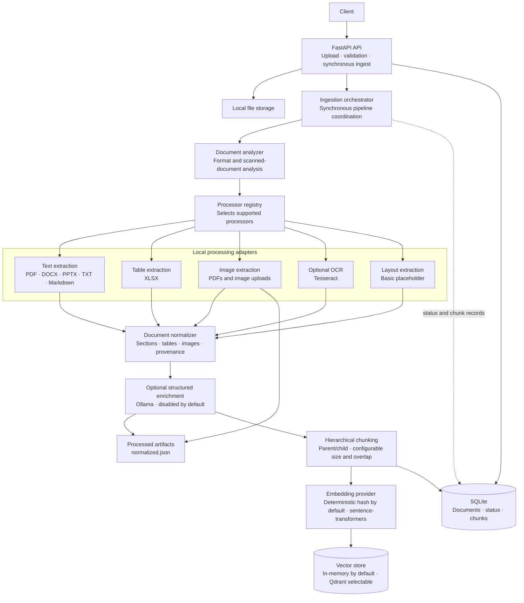

# RAG Document Ingestion Engine

A modular Python application for registering documents, extracting available text and
structured content, normalizing results, chunking them, generating embeddings, and
indexing chunks through a vector-store adapter. The current implementation is an
early-stage MVP; see [Implementation status](#15-current-implementation-status) for
what works and what remains incomplete.

## 1. Project overview

The engine exposes a FastAPI API and coordinates document ingestion through
replaceable interfaces for storage, processing, embeddings, language models, and
vector storage. It is designed as a modular monolith, not as a collection of
microservices.

## 2. Key capabilities

- Uploads configured document types, assigns document IDs, calculates SHA-256
  checksums, and detects duplicate content.
- Stores original files on the local filesystem and document/status/chunk metadata
  in SQLite.
- Analyzes PDFs and images and provides native text extraction for PDF, DOCX, PPTX,
  TXT, and Markdown; XLSX worksheets are read as table-like data.
- Provides image extraction for PDFs and image uploads, plus an optional Tesseract
  OCR adapter for scanned documents when the Tesseract executable is installed.
- Normalizes extraction results with page and processor provenance.
- Supports optional structured metadata enrichment using a local Ollama adapter.
- Creates hierarchical parent/child chunks and indexes them through either an
  in-memory development adapter or a Qdrant adapter.

The default upload MIME allowlist is configured in `.env`; it currently allows PDF,
TXT, Markdown, PNG, JPEG, and TIFF. Although parsers exist for DOCX, PPTX, and XLSX,
add their MIME types to `DOCUMENT_ALLOWED_MIME_TYPES` before uploading those formats
through the API.

## 3. Architecture overview



Core contracts and orchestration are separated from provider adapters. Local
filesystem, SQLite, Ollama, sentence-transformers, in-memory vectors, and Qdrant
implementations are selected or wired through application dependencies. This is a
modular monolith; background jobs and independently deployed processing workers are
not yet implemented.

The diagram shows the implemented local pipeline and its current defaults. Cloud
document-processing, vision, and hosted embedding providers are not implemented.

## 4. Technology stack

- Python 3.12+
- FastAPI and Uvicorn
- Pydantic and Pydantic Settings
- PyMuPDF, python-docx, python-pptx, openpyxl, Pillow
- Optional Tesseract executable for OCR
- Optional Ollama runtime for LLM enrichment
- sentence-transformers and Qdrant client adapters
- SQLite and local filesystem storage
- pytest, pytest-asyncio, and Ruff

Dependency ranges and development tools are declared in [pyproject.toml](pyproject.toml).

## 5. Project structure

```text
app/
├── api/                 # FastAPI routes, schemas, and dependency wiring
├── chunking/            # Chunk contracts and hierarchical strategy
├── core/                # Settings, contracts, interfaces, logging, exceptions
├── document/            # Document analysis and models
├── embeddings/          # Embedding interfaces and providers
├── ingestion/           # Orchestration and initial job abstraction
├── knowledge/           # Normalization and optional structured extraction
├── llm/                 # LLM contracts, Ollama adapter, prompt templates
├── processors/          # Processor contracts, registry, and extractors
├── storage/             # Local file and SQLite metadata adapters
└── vector_store/        # In-memory and Qdrant adapters
tests/                   # Unit, API, and end-to-end tests plus fixtures
docs/                    # Deployment and validation notes
scripts/                 # Local and Docker Compose launch helpers
Dockerfile
docker-compose.yml
pyproject.toml
```

## 6. Prerequisites

- Python 3.12 or newer within the supported range in `pyproject.toml`
- pip
- Optional: Tesseract installed and available on `PATH` for local OCR
- Optional: Ollama and a pulled model for LLM enrichment
- Optional: Docker Engine/Desktop and Docker Compose for container execution

Qdrant is not required for the default local development configuration. The Compose
configuration starts Qdrant for the containerized setup.

## 7. Python environment setup

From the project root:

```bash
python3.12 -m venv .venv312
source .venv312/bin/activate
python --version
```

On Windows PowerShell, activate with:

```powershell
.\.venv312\Scripts\Activate.ps1
```

## 8. Installation

Install the project and its development tools:

```bash
python -m pip install --upgrade pip
python -m pip install -e ".[dev]"
```

The `sentence-transformers` runtime dependency can pull in large machine-learning
packages even when using the default hash-embedding provider.

## 9. Environment configuration

Create a local `.env` from the example:

```bash
cp .env.example .env
```

Key development defaults in `.env.example`:

| Setting | Default | Purpose |
|---|---|---|
| `DOCUMENT_MAX_BYTES` | `52428800` | Maximum upload size |
| `DOCUMENT_ALLOWED_MIME_TYPES` | JSON array | Allowed upload MIME types |
| `LLM_ENABLED` | `false` | Keep enrichment disabled by default |
| `LLM_PROVIDER` | `disabled` | Set to `ollama` to use local Ollama |
| `LLM_MODEL` | `llama3.2:3b` | Ollama model name when enabled |
| `EMBEDDING_PROVIDER` | `deterministic_hash` | Development-only test embeddings |
| `EMBEDDING_MODEL` | `deterministic-v1` | Model name for configured embedding provider |
| `VECTOR_STORE_PROVIDER` | `memory` | Use `qdrant` to select Qdrant |
| `QDRANT_URL` | `http://127.0.0.1:6333` | Qdrant server URL |

`DOCUMENT_ALLOWED_MIME_TYPES` must be a JSON array, for example:

```dotenv
DOCUMENT_ALLOWED_MIME_TYPES=["application/pdf","text/plain","text/markdown","image/png","image/jpeg","image/tiff"]
```

Do not commit `.env` or credentials. The hash embedding adapter is only for local
demonstration/testing and is not suitable for semantic retrieval.

## 10. Running locally

With the virtual environment active and `.env` configured:

```bash
uvicorn app.main:app --reload
```

By default the API listens on `http://127.0.0.1:8000`. Check:

```bash
curl http://127.0.0.1:8000/api/v1/health
```

For a quick upload and ingestion check:

```bash
curl -F "file=@tests/fixtures/sample.txt;type=text/plain" \
  http://127.0.0.1:8000/api/v1/documents/upload
```

Use the returned `document_id` in:

```bash
curl -X POST http://127.0.0.1:8000/api/v1/documents/<document_id>/ingest
curl http://127.0.0.1:8000/api/v1/documents/<document_id>/status
curl http://127.0.0.1:8000/api/v1/documents/<document_id>/metadata
curl http://127.0.0.1:8000/api/v1/documents/<document_id>/chunks
```

## 11. Running with Docker

With Docker Engine/Desktop and Compose installed:

```bash
docker compose up --build
```

Compose starts the API and Qdrant and declares persistent volumes for application
data and Qdrant storage. Docker Compose has not been validated in the development
environment yet. See [deployment notes](docs/PHASE_6_DEPLOYMENT.md).

## 12. API documentation

When the local server is running:

- Swagger UI: [http://127.0.0.1:8000/docs](http://127.0.0.1:8000/docs)
- OpenAPI JSON: [http://127.0.0.1:8000/openapi.json](http://127.0.0.1:8000/openapi.json)
- Health: [http://127.0.0.1:8000/api/v1/health](http://127.0.0.1:8000/api/v1/health)

Implemented routes include upload, ingest, status, metadata, chunks, delete, and
health. Ingestion runs synchronously in the request at present.

## 13. Testing instructions

Run the checks from the project root:

```bash
python -m ruff check app tests
python -m pytest -q
python -m pip check
```

The tests cover upload duplicate detection, health/status behavior, text ingestion,
chunking, test embeddings, structured enrichment behavior, and an end-to-end text
flow. Docker, live Qdrant, OCR quality, and external LLM behavior require separate
environment-specific verification. More detail is in [validation notes](docs/VALIDATION.md).

## 14. Development workflow

1. Activate the Python 3.12 virtual environment and install requirements.
2. Read the relevant module contracts before changing a provider or pipeline stage.
3. Keep provider-specific code inside its adapter; keep orchestration focused on
   coordination.
4. Preserve document, page, section, and processor provenance when transforming
   content.
5. Add or update focused tests for behavior changes.
6. Run Ruff, pytest, and `pip check`.
7. Update this README and related documentation when capabilities or setup change.

Workspace Copilot guidance is in
[`.github/copilot-instructions.md`](.github/copilot-instructions.md). Reusable
workspace prompt files were not present when this README was updated.

## 15. Current implementation status

### Implemented

- FastAPI app, health route, upload, ingestion, status, metadata, chunks, and delete
  routes.
- Local filesystem storage, SQLite document/status/chunk metadata, and checksum
  duplicate detection.
- Basic PDF/image analysis and format-specific text extraction for PDF, DOCX, PPTX,
  TXT, and Markdown; XLSX sheet data extraction.
- Plugin registry and basic image extraction; optional Tesseract OCR adapter.
- Normalization, optional Ollama structured enrichment, hierarchical chunking,
  embedding interface, and in-memory/Qdrant vector-store adapters.
- Local test suite and Docker deployment files.

### Partial or not yet production-ready

- The layout processor is a basic placeholder; robust reading order and heading
  hierarchy are not implemented.
- PDF/DOCX table extraction is incomplete; current table extraction is for XLSX
  sheet data.
- OCR depends on a local Tesseract executable; PaddleOCR and Azure Document
  Intelligence adapters are not implemented.
- Only Ollama is provided as an LLM adapter; OpenAI/Azure OpenAI and vision adapters
  are not implemented.
- The sentence-transformers adapter exists but has not been validated against a
  downloaded model in the end-to-end test suite.
- Optional LLM enrichment currently returns empty enrichment on recognized provider
  or validation errors; structured enrichment failures are not yet represented in
  ingestion status.
- The Qdrant adapter exists but has not been verified against a live server; verify
  Qdrant point-ID compatibility before relying on Qdrant ingestion. Compose has not
  been run in this environment.
- Fixed, recursive, and semantic chunking strategies are not implemented.
- Ingestion is synchronous; the background job executor remains a placeholder.
- Document deletion currently removes metadata and vector records but does not yet
  remove the original file and processed artifacts from local storage.
- API authentication/authorization, rate limiting, robust retry/recovery, and
  PostgreSQL/object storage adapters are not implemented.

## 16. Future roadmap

1. Replace the placeholder job runner with a working in-process background executor
   and durable job/status handling.
2. Expand extraction tests and fixtures for Office files, scanned PDFs, tables, and
   complex layouts; improve section and reading-order detection.
3. Implement fixed/recursive chunking and add quality checks for chunk boundaries
   and table preservation.
4. Run live Qdrant and Docker Compose integration tests; add vector filtering and
   document cleanup verification.
5. Add provider adapters for cloud OCR, cloud LLM/embeddings, and vision where
   required.
6. Add production security, observability, resource controls, and alternate storage
   adapters.
